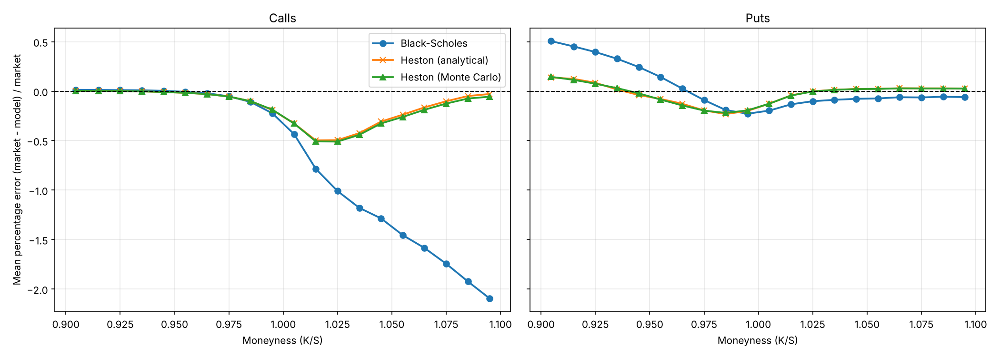
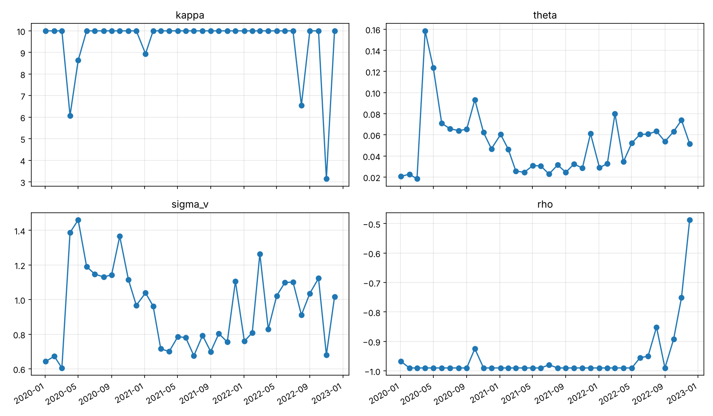

# Black-Scholes vs. Heston on SPY Options (2020–2022)

Code for my undergraduate thesis in Economics at PUC-SP, *"A Fronteira Estocástica na Precificação de Opções"* (The Stochastic Frontier in Option Pricing), graded 10/10. This version is reorganised and corrected; see [Corrections to the thesis version](#corrections-to-the-thesis-version) below.

The project asks two questions:

1. **Pricing accuracy.** Does a stochastic-volatility model (Heston) price SPY options better than Black-Scholes, and where (calls vs. puts, in / at / out of the money)?
2. **Economic value.** If you buy the options each model says are underpriced, does the better model also make more money?

## Pipeline

```
raw option chains ──► one row per option (call or put) ──► liquidity filters ──► VIX and T-Bill from D-1
        │
        ├─► Black-Scholes (σ = VIX)
        ├─► Heston calibration (SLSQP + Feller condition, recalibrated every month)
        ├─► Heston semi-analytical price (characteristic function + numerical integration)
        ├─► Heston Monte Carlo price (Euler scheme, Cholesky-correlated shocks)
        │
        ├─► pricing errors: RMSE, MAE, error by moneyness (calls and puts separately)
        └─► backtest: buy at the ask when ask < model × 0.80, hold to expiry
```

| Module | What it does |
|---|---|
| `src/data.py` | Loads the raw CSV, reshapes to one row per option, applies the filters and joins market data from the previous trading day |
| `src/pricing.py` | Black-Scholes (vectorised), Heston semi-analytical and Heston Monte Carlo |
| `src/calibration.py` | Heston calibration by period, with diagnostics for parameters stuck on their bounds |
| `src/backtest.py` | Mispricing strategy and performance metrics |
| `src/analysis.py` | Error statistics and charts |
| `src/db.py` | SQLite database: loads the raw data and runs the queries in `sql/` |
| `sql/` | Data step and analysis in SQL (see [SQL version](#sql-version)) |
| `run_pipeline.py` | Runs everything end to end |
| `tests/` | Unit tests: put-call parity, Heston → Black-Scholes limit, Monte Carlo vs. analytical, regression tests for each fix, and SQL-vs-pandas checks |

## Data

- **Options:** SPY end-of-day option chains, 2020–2022, from the Kaggle dataset *SPY Option Chains Q1 2020 – Q4 2022*. The file is too large for GitHub; see [`data/README.md`](data/README.md).
- **Market data:** VIX and SPY closes from Yahoo Finance, and the 3-month T-Bill (DGS3MO) from FRED. Downloaded automatically on the first run and cached in `data/market_data.csv`.

Filters (same as the thesis): volume > 100 contracts, mid price ≥ USD 0.50, bid-ask spread ≤ 15% of the mid, 7 to 180 days to expiry, moneyness K/S between 0.9 and 1.1.

| | Thesis logic | Corrected |
|---|---:|---:|
| Raw rows in the file (Jan 2020 – Dec 2022, 757 trading days) | 3,589,079 | 3,589,079 |
| Rows kept before the filters | 2,308,838 (no blank field) | 3,589,079 |
| Calls after filters | 173,011 | 187,831 |
| Puts after filters | 221,241 | 229,263 |
| **Total options** | **394,252** | **417,094** |

## How to run

```bash
pip install -r requirements.txt

# Unit tests
python -m pytest

# Full run on the real data (the Heston steps take a while)
python run_pipeline.py --options-csv data/spy_2020_2022.csv

# Quick run on 2% of the data
python run_pipeline.py --options-csv data/spy_2020_2022.csv --sample-frac 0.02

# Offline run on a small synthetic dataset priced with known Heston parameters
python -m scripts.make_sample_data
python run_pipeline.py --options-csv data/sample/sample_options.csv \
    --market-csv data/sample/sample_market.csv --out-dir results/sample
```

Outputs go to `results/`: priced options, calibrated parameters, error tables, charts and the backtest summary.

## SQL version

The data step and the analysis are also implemented in SQL (SQLite), with Python kept for the maths
(pricing and calibration). Run it with `--engine sql`; the database is built from the raw CSV on the first run.

| Query | What it does | SQL used |
|---|---|---|
| `01_schema.sql` | Tables for the raw option chains and market data | `CREATE TABLE`, indexes |
| `02_options_long.sql` | One row per option (call or put) with its own bid/ask/volume, plus the filters — the fix for the thesis bug | `UNION ALL`, `COALESCE`, CTEs |
| `03_attach_market_data.sql` | VIX and risk-free rate from the previous trading day | Correlated subqueries, `JOIN` |
| `04_error_by_bucket.sql` | RMSE, MAE and mean error by option type and moneyness bucket | `CASE`, `GROUP BY` |
| `05_trades.sql` | Backtest trades, first signal per contract, settled at expiry | `ROW_NUMBER() OVER (PARTITION BY ...)` |
| `06_backtest_summary.sql` | Trades, P&L, win rate, profit factor, ROI | Conditional aggregation |

`tests/test_sql.py` checks that every query returns exactly the same result as the pandas implementation,
on a synthetic dataset with edge cases (blank volumes, zero bids, holidays, values on the filter limits).

## Results

Full dataset: 417,094 options (187,831 calls and 229,263 puts), Jan 2020 – Dec 2022.

### 1. Pricing accuracy: Heston clearly wins

| Model | RMSE (USD) | MAE (USD) | RMSE calls | RMSE puts |
|---|---:|---:|---:|---:|
| Black-Scholes (σ = VIX) | 2.33 | 1.69 | 2.87 | 1.77 |
| Heston, semi-analytical | **1.48** | **1.09** | 1.56 | 1.41 |
| Heston, Monte Carlo (1,000 paths) | 1.51 | 1.11 | 1.59 | 1.44 |

- Heston cuts the pricing error by **37%** (RMSE) relative to Black-Scholes.
- The Monte Carlo price tracks the semi-analytical one closely, which is a useful check that both implementations are consistent.



The chart shows the volatility smile that Black-Scholes cannot capture with a single volatility. Using the VIX for every strike, it **overprices out-of-the-money calls** (K/S > 1, error down to −200%) and **underprices out-of-the-money puts** (K/S < 1, up to +50%). Heston's negative spot-volatility correlation (ρ) generates that skew, and its errors stay much closer to zero across strikes.

### 2. Calibration: the model is pushed to its limits



Monthly recalibration shows clear regimes: the long-run variance θ jumps from about 0.02 to 0.16 (≈ 14% → 40% volatility) after the COVID crash, falls during 2021 and rises again during the 2022 rate hikes. However, **κ sits on its upper bound (10) in 31 of the 36 months and ρ on its lower bound (−0.99) in 27**; only two months (Aug and Nov 2022) end with no parameter on a bound. The skew in SPY short-dated options is steeper than Heston can produce with v0 fixed at the VIX, so the optimiser pushes mean reversion and correlation to the extremes. Calibrating v0 together with the other parameters, or adding jumps (Bates model), are natural next steps.

### 3. Backtest: the thesis profits do not survive the data fix

Rule: buy at the ask when ask < model price × 0.80, hold to expiry.

| | Black-Scholes | Heston (analytical) | Heston (MC) |
|---|---:|---:|---:|
| Trades (first signal per contract) | 27,920 | 26,592 | 27,731 |
| Total P&L (USD) | −1,587,479 | −660,180 | −763,577 |
| Win rate | 26.0% | 22.1% | 22.1% |
| Profit factor | 0.84 | 0.90 | 0.89 |
| Max drawdown (USD) | −2,176,451 | −1,531,811 | −1,604,628 |
| Peak capital in open positions (USD) | 2,509,335 | 822,940 | 912,732 |
| ROI on total premium (thesis definition) | −9.9% | −6.7% | −7.2% |

The thesis reported positive ROIs between 67% and 92%. To find out why, the backtest was re-run on the corrected data with each change switched on and off:

| Entry price | Signals counted | BS trades | BS ROI | Heston ROI |
|---|---|---:|---:|---:|
| — | Thesis as published (original data step) | 148,565 | +67.1% | +92.1% |
| Mid (as in thesis) | Every day (as in thesis) | 151,401 | −6.5% | −1.5% |
| Mid | First signal only | 28,398 | −9.3% | −5.9% |
| Ask | Every day | 148,410 | −7.1% | −2.1% |
| Ask | First signal only | 27,920 | −9.9% | −6.7% |

For comparison, simply buying **every** option in the dataset once, at the ask, with no model at all, returns −8.3%.

Even with the thesis's own backtest rules, the strategy loses money once each option is compared with its own price. Black-Scholes does not depend on the calibration, so the profit reported in the thesis came mainly from issue #1 below (puts compared with the call's price). The backtest changes make the results more realistic but are not what flips the sign.

**Takeaway:** a better pricing model is not, by itself, a trading signal. Heston explains market prices much better, but "cheap relative to the model" mostly identifies options that are cheap for a reason, so buying them outright and holding to expiry loses money with either model. Heston loses less, and with a third of the capital. The results by year follow the direction of the S&P 500 (calls win in 2020–2021, puts in 2022), a sign that an unhedged long-option strategy is mostly a directional bet; a delta-hedged backtest is the natural next step to isolate the volatility signal.

## Corrections to the thesis version

While preparing this repository I reviewed the original script and found issues that affect the results. Fixing them was part of the work.

| # | Issue in the thesis script | Effect | Fix |
|---|---|---|---|
| 1 | Each raw row holds both the call and the put. The market price was set to the **call** mid whenever the call had any volume, *before* splitting calls and puts. | Re-running the original logic on the full dataset: **193,824 of the 221,241 puts (87.6%) were priced and filtered with the call's mid and spread.** This affected put errors, aggregate errors and many backtest trades. | Reshape to one row per option first; each option uses its own bid, ask and volume (`src/data.py`). |
| 1b | Rows were dropped when *any* numeric field was blank. In this dataset a blank volume means no trades. | A liquid put was discarded whenever the call at the same strike had no trades that day, and vice versa. | Blank volumes are treated as zero and each leg is filtered on its own. |
| 2 | Heston calibrated **once**, on the first day of 2020, and applied to all three years. Three of the four parameters ended on their bounds (κ ≈ 10, ρ = −0.99, Feller binding). | Parameters fitted to one day, and likely limited by the bounds rather than a true minimum. | Monthly recalibration with warm start, and a diagnostic column showing which parameters end on a bound (`src/calibration.py`). |
| 3 | Backtest counted a new trade every day the same contract kept signalling. | The same position was bought many times; trades were not independent. | Each contract is bought once, on its first signal. |
| 4 | Trades executed at the mid price. | Optimistic entry prices. | Entry at the ask. |
| 5 | ROI = P&L / sum of all premiums, and the equity curve booked P&L on the entry date. | ROI ignored how much capital was actually tied up; the drawdown curve used information from the future. | P&L booked at expiry; reports peak capital in open positions and return on that capital (the thesis ROI is kept for comparison). |
| 6 | Drawdown measured from the first trade, not from zero. | Early losses were not counted as drawdown. | Running peak starts at zero. |
| 7 | D-1 market data matched with `date − 1 business day` and an inner join. | Options quoted after a US holiday were dropped. | `merge_asof` on the last available date strictly before the quote date. |
| 8 | Monte Carlo without a fixed seed. | Results changed on every run. | Seeded generator (same paths for every option, which also reduces noise across strikes). |
| 9 | T-Bill yield used directly as a continuous rate. | Small bias. | r = ln(1 + y). |

## Limitations

- **VIX as a single volatility.** Black-Scholes uses the VIX for every strike and maturity, although the VIX measures 30-day implied volatility of the S&P 500. This is a deliberate simplification: it represents a practitioner who ignores the smile, which is the benchmark Heston is compared against.
- **v0 from the VIX.** The initial Heston variance is set to (VIX/100)² rather than calibrated.
- **Calibration objective.** The sum of squared price errors in dollars gives more weight to expensive (long-dated, in-the-money) options.
- **Backtest.** Positions are held to expiry with no hedging, no margin and no costs beyond the bid-ask spread. It measures whether the signals carry information, not a deployable strategy.
- **Monte Carlo.** 1,000 paths per option by default (configurable with `--mc-sims`); the Euler scheme has a small discretisation bias, which the tests bound.

## Author

Augusto Fonseca Campos Braga — [linkedin.com/in/augusto-fonseca](https://www.linkedin.com/in/augusto-fonseca/)
